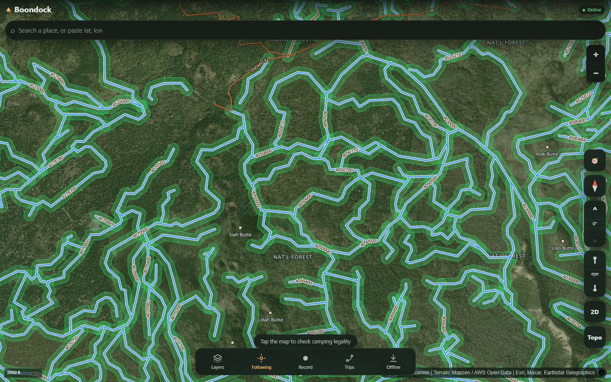

# Boondock

An open source, offline-first map for off-road navigation and **finding where dispersed (free) camping is legal** on U.S. public land. Built entirely on free, public-domain federal geodata, with no subscription and no account.



## What it does

- **Google Earth style 3D map.** Satellite imagery draped over 3D terrain with camera tilt, plus one-tap 2D/3D and Sat/Topo toggles. Basemaps: ESRI World Imagery, USGS Topo, USGS Imagery with labels, OSM streets.
- **Live camp corridor layer.** Green ribbons buffered along every open motorized road show where dispersed camping is likely legal, computed live across the western U.S.
- **Public land ownership.** Color coded and labeled by managing agency (BLM, USFS, NPS, State and more) from the BLM National Surface Management Agency dataset, generalized server side so it loads fast.
- **Roads and trails.** USFS MVUM roads and trails and BLM GTLF public motorized roads, with route number labels; tap to select and highlight.
- **Wilderness.** Red no-go zones for motorized use and dispersed camping, which also correct the verdict (wilderness inside a forest still reads as USFS in the raw data).
- **Campgrounds.** Developed USFS recreation sites as markers.
- **Camping legality.** Tap anywhere for a green, yellow or red verdict with its reasoning: land manager, nearest route and distance, elevation, stay limit, seasonal restrictions, caveats, and a ranger district link.
- **Search** any place, forest or town (OSM Nominatim), or paste a lat, lon.
- **Live GPS.** Location with accuracy ring, track recording, waypoints, GPX import and export.
- **Offline.** Download a region (PMTiles into OPFS) and it works with no signal.

## Architecture

The Python pipeline (`data/`) does the heavy GIS work: fetching federal datasets, buffering MVUM routes into camping corridors, clipping to public land, and baking the result into PMTiles vector tiles. The browser (`web/`) only does fast lookups against those tiles, plus live ArcGIS REST queries when online. There is no backend and no server cost, just static files.

```
web/     the PWA (Vite + React + TypeScript + MapLibre GL + PMTiles)
data/    the GIS pipeline (Python + uv, GeoJSON to tippecanoe to PMTiles)
```

## Quick start

```sh
# Web app
cd web
npm install
npm run dev          # http://localhost:5173

# Data pipeline (optional; the app works online without it)
cd ../data
uv sync
uv run python scripts/fetch_ownership.py --state OR
uv run python scripts/fetch_mvum.py --state OR
pwsh scripts/build_tiles.ps1 -Region pnw
```

When online, the app pulls public land and MVUM data live from federal ArcGIS REST services. Run the pipeline to bake offline PMTiles bundles and precomputed camping corridors.

## Data sources

All public domain unless noted.

| Layer | Source | Notes |
|---|---|---|
| Land ownership / manager | BLM National Surface Management Agency (SMA) | All agencies, not just BLM |
| Protected areas / wilderness | USGS PAD-US 4.1 | Manager + designation |
| Motorized roads and trails | USFS MVUM (Roads + Trails), BLM GTLF | Legal motorized access |
| Developed campgrounds | USFS / BLM recreation sites | For the 1-mile exclusion |
| Topo basemap | USGS The National Map | `basemap.nationalmap.gov` |
| Satellite | ESRI World Imagery / USGS Imagery | Attribution required |
| Terrain (3D + hillshade) | AWS Terrain Tiles (Mapzen) | `elevation-tiles-prod` |
| Streets | OpenFreeMap (OSM) | Attribution required (ODbL) |

## Limits

- **No live closure orders.** Forest and field office orders change constantly and are not in any central feed, so every verdict tells you to verify current closures with the ranger district.
- **No private parcel ownership.** That data is commercially licensed and camping does not need it; private or unmapped land is simply flagged.
- **Satellite is online only by default** (too large to bundle); topo and overlays download for offline use.
- **iOS PWAs cannot track GPS in the background.** Fine while the app is open.
- **Verdicts are guidance, not legal advice.** Always check posted signs and the managing agency.

## License

[MIT](LICENSE). Basemap and data providers keep their own terms; see the attribution shown in the app.
