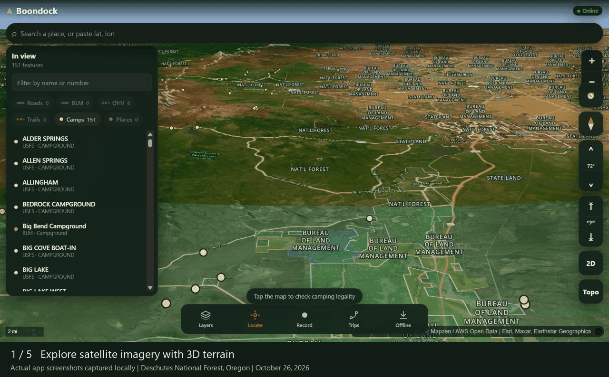
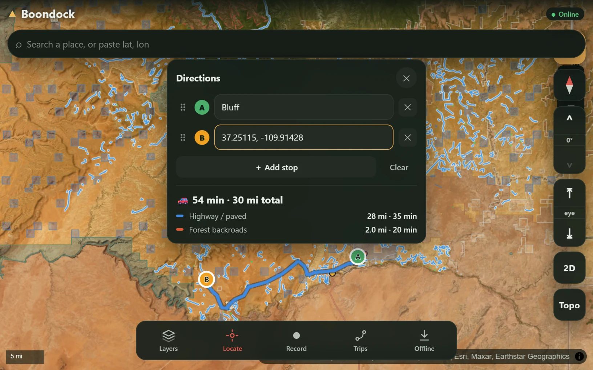

# Boondock

An open source, offline-first map for off-road navigation and **finding where dispersed (free) camping is legal** on U.S. public land. Built entirely on free, public-domain federal geodata, with no subscription and no account.

Tap anywhere on the map and get a green, yellow or red camping verdict with the reasoning behind it. A Python GIS pipeline bakes federal datasets into PMTiles vector tiles, and a static browser app reads them with no backend. Watch the walkthrough below, or run it locally (see [Quick start](#quick-start)).

**Status:** personal project, single operator. The web app works online without the pipeline. Region tiles are built locally by the pipeline and are not checked in.

## Walkthrough



Five real app views captured locally around Deschutes National Forest, Oregon: satellite terrain, public land overlays, a 2D topographic map, a USFS campground, and camping guidance. The walkthrough is a paced sequence of screenshots from the running app. Camping guidance requires checking current agency rules and closures.

## Routing preview



Route planning separates the paved drive from the forest-road approach to a campsite.

## What it does

- **Google Earth style 3D map.** Satellite imagery draped over 3D terrain with camera tilt, plus one-tap 2D/3D and Sat/Topo toggles. Basemaps include ESRI World Imagery, USGS Topo, USGS Imagery with labels and OpenStreetMap streets.
- **Live camp corridor layer.** Green ribbons buffered along every open motorized road show where dispersed camping is likely legal, computed live
- **Public land ownership.** Color coded and labeled by managing agency (BLM, USFS, NPS, State and more) from the BLM National Surface Management Agency dataset, generalized server side so it loads fast.
- **Roads and trails.** USFS MVUM roads and trails and BLM GTLF public motorized roads, with route number labels; tap to select and highlight.
- **Wilderness.** Red no-go zones for motorized use and dispersed camping, which also correct the verdict (wilderness inside a forest still reads as USFS in the raw data).
- **Campgrounds.** Developed campgrounds as markers, from USFS, BLM and California and Washington state services.
- **Camping legality.** Tap anywhere for a green, yellow or red verdict with its reasoning: land manager, nearest route and distance, elevation, stay limit, seasonal restrictions, caveats, and a ranger district link.
- **Search** any place, forest or town (OSM Nominatim), or paste a lat, lon.
- **Live GPS.** Location with accuracy ring, track recording, waypoints, GPX import and export.
- **Offline.** Download a region (PMTiles into OPFS) and it works with no signal.

## Architecture

The Python pipeline (`data/`) does the heavy GIS work: fetching federal datasets, buffering MVUM routes into camping corridors, clipping to public land, and baking the result into PMTiles vector tiles. The browser (`web/`) only does fast lookups against those tiles, plus live ArcGIS REST queries when online. There is no backend and no server cost, just static files.

Pipeline stages (`data/scripts/`): `fetch_ownership.py` (BLM SMA), `fetch_mvum.py` (USFS MVUM), `fetch_trails_poi.py` (NFS trails and POIs), `build_corridors.py` (buffer open motorized routes by 91 m, about 300 ft, and clip to USFS and BLM land), then `build_tiles.ps1` (merge layers and run tippecanoe at zoom 5 to 14). Regions: `pnw` (WA, OR, ID), `pacific` (CA, NV), `mountain-west` (CO, UT, AZ, NM, WY, MT).

```
web/     the PWA (Vite + React + TypeScript + MapLibre GL + PMTiles)
data/    the GIS pipeline (Python + uv, GeoJSON to tippecanoe to PMTiles)
```

## Quick start

```sh
# Web app (Node, npm)
cd web
npm install
npm run dev          # http://localhost:5173

# Data pipeline (optional; the app works online without it)
# Needs uv, PowerShell 7 (pwsh) and Docker (tippecanoe runs as felt/tippecanoe)
cd ../data
uv sync
uv run python scripts/fetch_ownership.py --region pnw
uv run python scripts/fetch_mvum.py --region pnw
uv run python scripts/build_corridors.py --region pnw
pwsh scripts/build_tiles.ps1 -Region pnw     # writes web/public/tiles/pnw.pmtiles
```

Checks: `npm run typecheck` in `web/`, and `node web/src/legality/season.selfcheck.mjs` for the MVUM date parser. `web/smoke.mjs` is a Playwright smoke test against the dev server (Playwright is not a listed dependency; the script header says how to install it).

When online, the app pulls public land and MVUM data live from federal ArcGIS REST services. Run the pipeline to bake offline PMTiles bundles and precomputed camping corridors.

## Data sources

All public domain unless noted.

| Layer | Source | Notes |
|---|---|---|
| Land ownership / manager | BLM National Surface Management Agency (SMA) | All agencies, not just BLM |
| Wilderness | USFS EDW Wilderness | Queried live; PAD-US is a planned input for the baked corridors |
| Motorized roads and trails | USFS MVUM (Roads + Trails), BLM GTLF | Legal motorized access |
| Developed campgrounds | USFS and BLM recreation sites, CA and WA state services | Map markers; the baked 1-mile exclusion is not built yet |
| Topo basemap | USGS The National Map | `basemap.nationalmap.gov` |
| Satellite | ESRI World Imagery / USGS Imagery | Attribution required |
| Terrain (3D + hillshade) | AWS Terrain Tiles (Mapzen) | `elevation-tiles-prod` |
| Streets | OpenFreeMap (OSM) | Attribution required (ODbL) |

## Limits

- **Baked corridors are a first cut.** `build_corridors.py` does not yet subtract Wilderness or a 1-mile buffer around developed campgrounds (documented TODO in `data/README.md`). The in-app verdict does check Wilderness.
- **No live closure orders.** Forest and field office orders change constantly and are not in any central feed, so every verdict tells you to verify current closures with the ranger district.
- **No private parcel ownership.** That data is commercially licensed and camping does not need it; private or unmapped land is simply flagged.
- **Satellite is online only by default** (too large to bundle); topo and overlays download for offline use.
- **iOS PWAs cannot track GPS in the background.** Fine while the app is open.
- **Verdicts are guidance, not legal advice.** Always check posted signs and the managing agency.

## License

[MIT](LICENSE). Basemap and data providers keep their own terms; see the attribution shown in the app.

## More projects

More of my work and contact details are at [twhite.dev](https://twhite.dev).
